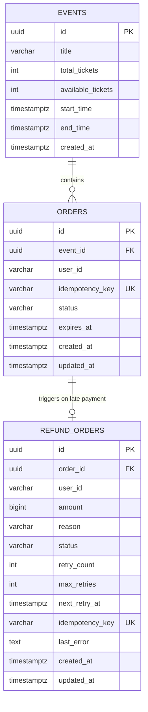
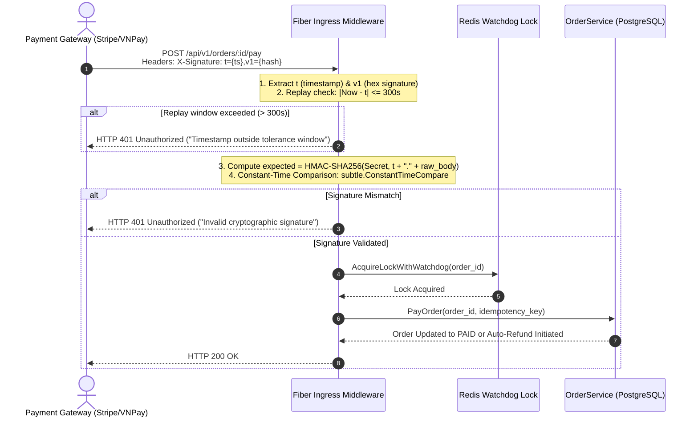
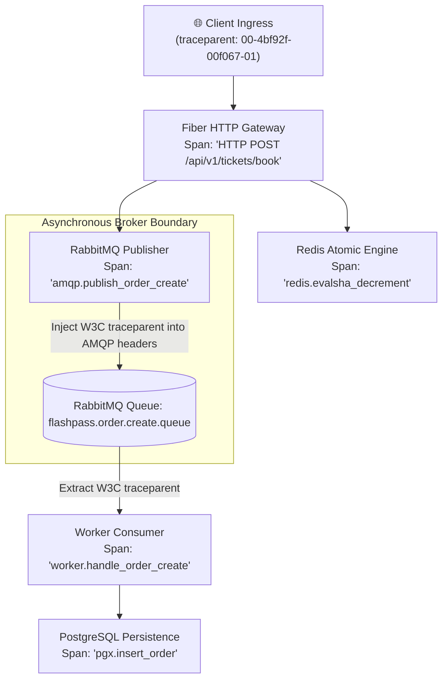

# ARCHITECTURE.md: FlashPass Technical Blueprint

> **Project Links:** [Master README](./README.md) • [System Spec](./SPEC.md) • [Execution Tasks](./TASKS.md) • [Agent Rules](./AGENTS.md) • [API Reference](./docs/API_REFERENCE.md) • [Operational Runbook](./docs/RUNBOOK.md) • [Edge Cases Compendium](./docs/DISTRIBUTED_EDGE_CASES.md)

## 1. System Components
- **API Server / Ingestion Layer:** Go (Fiber / Gin) or NestJS (Fastify) exposing HTTP endpoints.
- **Frontend Client & Live Dashboard:** Next.js 15 (App Router), Tailwind CSS, Lucide Icons, Server-Sent Events (SSE) or WebSockets for real-time inventory updates.
- **In-Memory Cache & Atomic Engine:** Redis (v7.x) with Redis Lua scripts for concurrency control.
- **Message Broker:** RabbitMQ (v3.13+) with `rabbitmq_delayed_message_exchange` plugin.
- **Persistent Storage:** PostgreSQL (v16+) storing `events`, `users`, `orders`, `tickets`.
- **Infrastructure:** Docker Compose multi-container setup.
- **Testing & Benchmarking Suite:** k6 load testing scripts.

## 2. Redis Key Design & Lua Script
### Key Namespaces (Hash Tag Co-located):
- `flashpass:{event_id}:stock` (Integer) -> Remaining ticket count in RAM.
- `flashpass:{key}:idempotency` (String, TTL: 30s) -> Stores user reservation token.
- `flashpass:{event_id}:user_booked:{user_id}` (Boolean, TTL: 10m30s / 630s) -> Enforce 1 ticket per user limit (aligned with 10-minute payment timeout).

### Atomic Inventory Decrement (Lua Script):
```lua
-- KEYS[1]: flashpass:{event_id}:stock
-- KEYS[2]: flashpass:{event_id}:user_booked:{user_id}
-- ARGV[1]: user_id
-- ARGV[2]: quantity (e.g., 1)

if redis.call('EXISTS', KEYS[2]) == 1 then
    return -2 -- Already booked by this user
end

local current_stock = tonumber(redis.call('GET', KEYS[1]) or "0")
local quantity = tonumber(ARGV[2])

if current_stock >= quantity then
    redis.call('DECRBY', KEYS[1], quantity)
    redis.call('SET', KEYS[2], "1", 'EX', 630)
    return 1 -- Success
else
    return -1 -- Sold out
end
```

## 3. Database Schema (PostgreSQL)



```sql
CREATE EXTENSION IF NOT EXISTS "pgcrypto";

-- Table: events
CREATE TABLE IF NOT EXISTS events (
    id UUID PRIMARY KEY DEFAULT gen_random_uuid(),
    title VARCHAR(255) NOT NULL,
    total_tickets INT NOT NULL,
    available_tickets INT NOT NULL,
    start_time TIMESTAMPTZ NOT NULL,
    end_time TIMESTAMPTZ NOT NULL,
    created_at TIMESTAMPTZ DEFAULT NOW()
);

-- Table: orders
CREATE TABLE IF NOT EXISTS orders (
    id UUID PRIMARY KEY DEFAULT gen_random_uuid(),
    event_id UUID NOT NULL REFERENCES events(id) ON DELETE CASCADE,
    user_id VARCHAR(64) NOT NULL,
    idempotency_key VARCHAR(128) UNIQUE NOT NULL,
    status VARCHAR(32) NOT NULL DEFAULT 'PENDING_PAYMENT', -- PENDING_PAYMENT, PAID, EXPIRED, REFUND_PENDING, REFUNDED, CANCELLED
    expires_at TIMESTAMPTZ NOT NULL,
    created_at TIMESTAMPTZ DEFAULT NOW(),
    updated_at TIMESTAMPTZ DEFAULT NOW()
);

-- Table: refund_orders (Automatic Refund Pipeline)
CREATE TABLE IF NOT EXISTS refund_orders (
    id UUID PRIMARY KEY DEFAULT gen_random_uuid(),
    order_id UUID NOT NULL REFERENCES orders(id) ON DELETE CASCADE,
    user_id VARCHAR(64) NOT NULL,
    amount BIGINT NOT NULL DEFAULT 0,
    reason VARCHAR(255) NOT NULL,
    status VARCHAR(32) NOT NULL DEFAULT 'PENDING', -- PENDING, PROCESSING, SUCCESS, FAILED
    retry_count INT NOT NULL DEFAULT 0,
    max_retries INT NOT NULL DEFAULT 5,
    next_retry_at TIMESTAMPTZ NOT NULL DEFAULT NOW(),
    idempotency_key VARCHAR(128) UNIQUE NOT NULL,
    last_error TEXT,
    created_at TIMESTAMPTZ DEFAULT NOW(),
    updated_at TIMESTAMPTZ DEFAULT NOW()
);

-- Indexes for performance and high-throughput query optimization
CREATE INDEX IF NOT EXISTS idx_orders_event_status ON orders(event_id, status);
CREATE INDEX IF NOT EXISTS idx_orders_idempotency ON orders(idempotency_key);
CREATE INDEX IF NOT EXISTS idx_orders_user_event ON orders(user_id, event_id);
CREATE INDEX IF NOT EXISTS idx_refund_orders_retry ON refund_orders(status, next_retry_at);
CREATE INDEX IF NOT EXISTS idx_refund_orders_order_id ON refund_orders(order_id);
```

## 4. RabbitMQ Queue & Exchange Topology
- **Exchange:** `flashpass.order.exchange` (Topic Exchange)
  - **Queue:** `flashpass.order.create.queue` (Routing Key: `order.create`) -> Order persistence worker.
  - **Queue:** `flashpass.order.refund.queue` (Routing Key: `order.refund`) -> Automated payment refund worker with retry.
- **Delayed Exchange:** `flashpass.order.delayed.exchange` (`x-delayed-message`)
  - **Queue:** `flashpass.order.timeout.queue` -> Listens for 10-minute expiration check.

## 5. In-Browser Benchmark Architecture & API Extensions
### Dynamic Reset Endpoint:
- `POST /api/v1/admin/events/:id/reset`
  - Optional JSON Body: `{ "tickets": 500 }` (defaults to event's initial total tickets if omitted).
  - Truncates existing orders for the event in PostgreSQL.
  - Flushes Redis booking tags `flashpass:user_booked:{event_id}:*` and sets `flashpass:stock:{event_id}` to specified tickets count.

### Frontend Benchmark Simulator (Client-side Engine):
- Dispatches concurrent asynchronous promises in configurable batches (e.g., 20 - 100 concurrent workers).
- Accumulates response latencies in real-time array to compute `min`, `avg`, `p90`, `p95`, `p99`.
- Tracks `tickets_accepted_202`, `tickets_sold_out_409`, `tickets_error_5xx`.
- Stores run summaries in browser `localStorage` (`flashpass_benchmark_history`) without polluting PostgreSQL.


## 6. Distributed Failure Modes & Overselling Prevention Architecture
### 1. Redis Master-Replica Asynchronous Failover (Split-Brain)
- **Problem:** When Redis Master crashes before streaming Lua decrements to Replica, failover election promotes a Replica containing stale inventory -> Double booking.
- **Mitigation:**
  - `WAIT numreplicas timeout`: Require synchronous acknowledgement from at least 1 replica before returning success.
  - Or Redis Raft / Redlock across independent master nodes.
  - At persistence tier: Unique constraint on `(event_id, ticket_seat_id)` in PostgreSQL guarantees database reject if duplicate reservation reaches DB.

### 2. Timeout Worker vs Late Payment Race Condition
- **Problem:** Worker marks order `EXPIRED` and increments stock at 10m00s, while Payment Webhook confirms payment at 10m01s.
- **Mitigation:**
  - Optimistic State Machine: Worker executes atomic conditional SQL:
    `UPDATE orders SET status = 'EXPIRED' WHERE id = $1 AND status = 'PENDING_PAYMENT' RETURNING id;`
  - Only increment Redis stock (`INCRBY`) if row was successfully updated to `EXPIRED`.
  - If payment webhook arrives after `EXPIRED`, payment handler initiates automatic payment refund instead of fulfilling ticket.

### 3. Dual-Write Partial Failure (Redis vs RabbitMQ Desync)
- **Problem:** Redis decrements stock, but process crashes before `amqp.Publish` delivers message to RabbitMQ -> Ghost inventory (stock decremented, no order created).
- **Mitigation:**
  - Transactional Outbox Pattern: Save reservation to a persistent local outbox before returning 202.
  - Periodic Stock Reconciliation Auditor: Background cron & admin endpoint `POST /api/v1/admin/events/:id/reconcile` reconciles `Redis Stock + Pending Orders + Paid Orders == Total Event Stock` and self-heals desyncs.
  - Contract: Returns `{ "event_id": id, "initial_tickets": total, "active_orders": cnt, "expected_stock": exp, "actual_stock": act, "healed": bool }`.


## 7. Frontend Component Architecture: Modular Edge Cases Lab
```
frontend/
  ├── components/
  │   └── edge-cases/
  │       ├── EdgeCasesLab.tsx          # Master interactive container with tabs
  │       ├── FailoverSimulation.tsx    # Redis Master-Replica split-brain simulator
  │       ├── TimeoutRaceSimulation.tsx # Timeout worker vs Late webhook race simulator
  │       ├── DualWriteSimulation.tsx   # Dual-write crash & Ghost Inventory simulator
  │       └── CrossSlotSimulation.tsx   # Redis Cluster Cross-Slot hash-tag simulator
  └── app/
      └── page.tsx                      # Ingests EdgeCasesLab component into main tab navigation
```
- **State Management:** Fully client-side state machine without backend dependencies.
## 8. Real Multi-Node Failover Chaos API Engine
### Docker Infrastructure:
- `flashpass_redis`: Master instance on port `6379`.
- `flashpass_redis_replica`: Replica instance on port `6380` (`replicaof redis 6379`).

### Failover Chaos Endpoints:
- `POST /api/v1/admin/redis/master/toggle`: Executes `docker pause flashpass_redis` or `docker unpause flashpass_redis` to freeze/unfreeze Master.
- `GET /api/v1/admin/redis/master/status`: Queries container state via Redis Ping with 500ms timeout.
- `POST /api/v1/admin/failover/init`: Resets Redis Master & Replica to 1 ticket, clears past test orders, and re-attaches replication stream.
- `POST /api/v1/admin/failover/book-master?wait=true|false`: Simulates Client A purchasing ticket. If `wait=true`, executes synchronous `WAIT 1 2000` before responding.
- `POST /api/v1/admin/failover/crash-master`: Pauses Master container to simulate sudden hardware/power outage.
- `POST /api/v1/admin/failover/promote-replica`: Simulates Sentinel electing replica via `REPLICAOF NO ONE`.
- `POST /api/v1/admin/failover/book-replica`: Client B purchases ticket on promoted replica. Returns `202 Accepted` (overselling) if async packet was dropped, or `409 Sold Out` if `WAIT 1` synchronized stock.
- `GET /api/v1/admin/failover/audit`: Direct PostgreSQL `orders` table audit returning order count and `overselling` boolean flag.

## 9. Distributed Edge Cases & Self-Healing Architecture
### 9.1 Auto-Refund Engine for Late Payment Webhooks (Edge Case 2)
- **Table:** `refund_orders`
  ```sql
  CREATE TABLE IF NOT EXISTS refund_orders (
      id UUID PRIMARY KEY DEFAULT gen_random_uuid(),
      order_id UUID NOT NULL REFERENCES orders(id) ON DELETE CASCADE,
      user_id VARCHAR(64) NOT NULL,
      amount BIGINT NOT NULL DEFAULT 0,
      reason VARCHAR(255) NOT NULL,
      status VARCHAR(32) NOT NULL DEFAULT 'PENDING',
      retry_count INT NOT NULL DEFAULT 0,
      max_retries INT NOT NULL DEFAULT 5,
      next_retry_at TIMESTAMPTZ NOT NULL DEFAULT NOW(),
      idempotency_key VARCHAR(128) UNIQUE NOT NULL,
      last_error TEXT,
      created_at TIMESTAMPTZ DEFAULT NOW(),
      updated_at TIMESTAMPTZ DEFAULT NOW()
  );

  CREATE INDEX IF NOT EXISTS idx_refund_orders_retry ON refund_orders(status, next_retry_at);
  CREATE INDEX IF NOT EXISTS idx_refund_orders_order_id ON refund_orders(order_id);
  ```
- **Atomic State Transition via Writable CTE:**
  ```sql
  WITH updated AS (
      UPDATE orders 
      SET status = 'REFUND_PENDING', updated_at = NOW() 
      WHERE id = $1 AND status = 'EXPIRED' 
      RETURNING id, user_id
  )
  INSERT INTO refund_orders (order_id, amount, reason, status)
  SELECT id, 100.00, 'Order expired before payment was confirmed. Auto-refund initiated.', 'PENDING'
  FROM updated
  RETURNING id;
  ```
- **RabbitMQ Refund Queue:** `flashpass.order.refund.queue` (routing key `order.refund`).
- **Background Retry Scheduler:** Runs every 30s in `backend/internal/consumer/consumer.go`, selecting `PENDING` refunds with exponential backoff (`retry_count < 5`), requeueing to RabbitMQ.

### 9.2 Stock Reconciliation Engine (Stock Auditor - Edge Case 3)
- **Endpoint:** `POST /api/v1/admin/events/:id/reconcile`
- **Ghost Inventory Formula:**
  $$\text{Expected Stock} = \text{Total Tickets} - (\text{PAID Orders} + \text{PENDING\_PAYMENT Orders})$$
  $$\text{Discrepancy (Ghost Tickets)} = \text{Expected Stock} - \text{Actual Redis Stock}$$
- **Self-Healing Action:** If $\text{Discrepancy} > 0$, atomic overwrite of Redis stock key `flashpass:stock:{eventId}` and update PostgreSQL `events.available_tickets` to restore lost inventory back to public sale.
- **Queue-Depth-Aware Autonomous Cronjob (`runReconileStockScheduler`):**
  - **RabbitMQ Inspection:** Calls `p.GetQueueDepth("flashpass.order.create.queue")` via `ch.QueueInspect`.
  - **Queue Depth = 0 (Instant Heal):** Zero messages in flight $\rightarrow$ 100% ghost inventory confirmed. Heals immediately on the first cycle (prevents False Sold-Out and end-of-event stuck inventory).
  - **Queue Depth > 0 (Debounce Mode):** Messages currently in flight $\rightarrow$ Waits for 2 consecutive cycles with identical discrepancy to guarantee workers have finished persisting before executing stock restoration.

### 9.3 Zero-Second Reactive Emergency Audit (Fast-Path Hit-Zero Trigger)
- **Lua Script Zero Signal:** `BookTicketLuaScript` returns `ResultSuccessHitZero = 2` when remaining stock drops to 0, or `ResultSoldOut = -1` when attempted booking sees 0.
- **Thundering Herd Guard:** Distributed Redis lock `flashpass:audit_lock:{eventId}` with TTL 5s via `SETNX`. Only the first request triggers the check; subsequent requests exit immediately.
- **500ms Settle Window:** Background goroutine sleeps 500ms to allow in-flight RabbitMQ consumer writes to complete in PostgreSQL, then invokes `PerformReconciliation`.
- **Eliminates Polling Blind Spot:** Instantly restores false sold-out inventory in the critical closing seconds without waiting for the 1-minute cronjob.

### 9.4 Two-Way Stock Clamping & Orphaned User Lock Resolution
- **Two-Way Reconciliation (`discrepancy != 0`):**
  - **Deficit (`discrepancy > 0`):** Restores missing ghost tickets to Redis to resume sales.
  - **Surplus (`discrepancy < 0`):** Clamps Redis stock down to `expectedStock` to eliminate over-allocated tickets and prevent overselling (> 0%).
- **Orphaned User Lock Self-Healing:**
  - **TTL Alignment:** Decreased `flashpass:user_booked:{eventId}:{userId}` TTL from 1 hour (`3600s`) to 10m30s (`630s`), aligning with the order reservation timeout.
  - **Admin Unlock API:** `POST /api/v1/admin/events/:id/users/:userId/unlock` checks PostgreSQL for active/paid orders. If none exist (confirming a crash occurred before order creation), clears the stale lock and allows the user to re-book.

### 9.5 Dead Letter Queue (DLQ) & Poison Pill Isolation (Edge Case 5)
- **Dead Letter Exchange (DLX):** `flashpass.dlx` (topic exchange) bound to `flashpass.order.dlq` via routing key `order.dlq`.
- **Main Queue Configuration:** `flashpass.order.create.queue` declared with `x-dead-letter-exchange: flashpass.dlx` and `x-dead-letter-routing-key: order.dlq`.
- **Infinite Loop Prevention:**
  - First failure (`!d.Redelivered`): Requeues message once via `d.Nack(false, true)` for transient retry.
  - Second failure (`d.Redelivered`): Confirmed poison pill. Invokes `s.redis.RollbackStock(...)` to recover inventory on Redis and rejects with `d.Nack(false, false)` to route message to DLQ without blocking the main queue.

### 9.6 Cache Stampede & SingleFlight Request Coalescing (Edge Case 6)
- **Problem:** Thousands of concurrent users refreshing `GET /api/v1/events/:id` when cache expires leads to PostgreSQL connection pool exhaustion.
- **SingleFlight Coalescing:** `h.sf.Do(eventIDStr, ...)` suppresses concurrent identical in-flight reads into a single PostgreSQL execution, broadcasting results to all callers.
- **Cache-Aside Layering:** Metadata cached in Redis key `flashpass:{event_id}:meta` with 5-minute TTL, combining static metadata with dynamic real-time inventory from `flashpass:{event_id}:stock`.

### 9.7 Double Payment Webhook Concurrency & Distributed Lock (Edge Case 7)
- **Problem:** Multiple payment gateway retries hit `POST /api/v1/orders/:id/pay` simultaneously, causing duplicate status updates, false 500 error storms, or double refund issuance.
- **Distributed Lock:**
  - Acquired via `redis.PayLockKey(orderID)` (`flashpass:lock:pay:{order_id}`) with 5s TTL.
  - Winner executes state transition; loser waits 100ms and re-reads DB order status.
  - Winner-only lock release: `defer ReleaseLock` is strictly bound to `acquired == true` to avoid lock hijacking.
- **Idempotent Webhook Fallback:**
  - If `UpdateStatus` returns `RowsAffected == 0`, re-check order status. If already `PAID`, return `200 OK` (idempotent success) instead of erroring.
- **Deduplicated Auto-Refund:**
  - Expired orders receiving concurrent webhooks create exactly 1 row in `refund_orders` guarded by `UNIQUE(order_id)` / idempotency key.

### 9.8 Clock Drift / NTP Desynchronization Guard (Edge Case 8)
- **Problem:** Distributed API nodes, background worker instances, and database servers experience clock skew (NTP drift, virtualization tick loss). Orders may be falsely rejected or prematurely expired.
- **Architecture Defense:**
  1. **Clock Drift Grace Window:** In `OrderService.PayOrder`, accept payments if `time.Now() <= order.ExpiresAt + ClockDriftGraceWindow` (5s), preventing network latency or clock skew from blocking valid payments.
  2. **Database-Authoritative Atomic Expiration:** In background timeout worker, order expiration is guarded by PostgreSQL:
     ```sql
     UPDATE orders 
     SET status = 'EXPIRED', updated_at = NOW() 
     WHERE id = $1 AND status = 'PENDING_PAYMENT' AND expires_at <= NOW()
     RETURNING id;
     ```
     Fast worker clocks cannot expire orders before database `NOW() >= expires_at`.
  3. **Relative TTL Invariance:** RabbitMQ message delays use relative duration (`time.Until(expires_at)`) rather than distributed wall-clock timestamps.

### 9.9 Distributed Sliding-Window Rate Limiting (Edge Case 9)
- **Problem:** Scalper botnets and automated scrapers spamming `POST /api/v1/tickets/book` can exhaust Redis connection pools and starve legitimate buyers during the first second of a flash sale.
- **Sliding-Window Log in Redis Lua:**
  - Key: `flashpass:ratelimit:{user_id_or_ip}` (using Hash Tag co-location `{...}`).
  - Data Structure: Redis Sorted Set (`ZSET`) where `score = timestamp_ms` and `member = timestamp_ms:request_uuid`.
  - Lua Execution Steps:
    1. `ZREMRANGEBYSCORE key -inf (now - window_ms)`: Purges expired entries outside the sliding window.
    2. `ZCARD key`: Counts current requests within the active window.
    3. If `currentCount < maxLimit`:
       - `ZADD key now member`
       - `EXPIRE key ceil(window_sec)`
       - Returns `{allowed = 1, remaining = maxLimit - currentCount - 1}`.
    4. If `currentCount >= maxLimit`:
       - Returns `{allowed = 0, retry_after = ceil((oldest_ts + window_ms - now) / 1000)}`.
- **API Guard:** Fiber middleware rejects non-compliant requests immediately with HTTP `429 Too Many Requests`, `Retry-After: N` header, and zero database/RabbitMQ interaction.

### 9.10 Out-of-Order Message Processing & Asynchronous Inversion (Edge Case 10)
- **Problem:** Due to concurrent worker goroutines or network latency variance, sequential operations may arrive out of order:
  1. **Early Payment:** Payment webhook arrives before RabbitMQ consumer inserts the new order in PostgreSQL.
  2. **Early Cancellation:** User or timeout cancels an order before RabbitMQ consumer inserts the order row.
- **Architectural Safeguards:**
  - **Early Payment In-Flight Debounce:** In `orderService.PayOrder`, if `orderRepo.GetByID` returns `ErrOrderNotFound`, the handler executes a 100ms debounce wait before re-checking, allowing in-flight RabbitMQ worker persistence to commit without generating false 404s.
  - **Pre-Creation Tombstone Guard:** In `orderRepo.CancelOrTombstone`, if the order does not exist yet, a tombstone row is inserted with `status = 'CANCELLED'`.
  - **State Machine Protection on Insert:**
    ```sql
    INSERT INTO orders (id, event_id, user_id, idempotency_key, status, expires_at, created_at, updated_at)
    VALUES ($1, $2, $3, $4, $5, $6, NOW(), NOW())
    ON CONFLICT (id) DO UPDATE 
    SET status = CASE 
        WHEN orders.status = 'CANCELLED' THEN 'CANCELLED' 
        WHEN orders.status = 'PAID' THEN 'PAID' 
        ELSE EXCLUDED.status 
    END;
    ```
    Guarantees that a delayed `order.create` worker can never overwrite a `CANCELLED` or `PAID` state back into `PENDING_PAYMENT`.

### 9.11 Database Cascading Failure & Circuit Breaker Protection (Edge Case 11)
- **Problem:** When PostgreSQL connection pool (`max_conns = 50`) is exhausted or database stalls under extreme load, incoming goroutines pile up by the thousands. Memory balloons, garbage collection halts, and the entire Fiber API server crashes (Cascading Failure).
- **Circuit Breaker State Machine (`resilience.CircuitBreaker`):**
  - **Thread-Safe Mutex Guard:** Protects state transitions between `CLOSED`, `OPEN`, and `HALF_OPEN`.
  - **Consecutive Error Trigger:** When database operations fail $N$ consecutive times (default: 3), the circuit trips to `OPEN`.
  - **Zero-Latency Fast-Fail:** Subsequent requests are shed immediately (0ms) without executing database queries or blocking connections, returning `ErrCircuitOpen` $\rightarrow$ HTTP `503 Service Unavailable`.
  - **Canary Recovery (Half-Open):** After `CooldownPeriod` (e.g. 1.5s), the circuit admits a single canary probe. If successful, state resets to `CLOSED`; if the probe fails, the circuit returns to `OPEN` for another cooldown window.

### 9.12 Split-Brain Distributed Lock & Lock Heartbeat Watchdog (Edge Case 12)
- **Problem:** Fixed TTL on distributed locks introduces a dangerous split-brain race condition:
  - Worker A acquires lock with 5s TTL.
  - Due to GC pause or slow 3rd-party payment gateway, task takes 6.5s.
  - At 5.0s, Redis automatically expires the lock.
  - Worker B acquires the newly released lock, resulting in **two active threads processing the exact same order simultaneously**.
  - At 6.5s, Worker A finishes and calls `ReleaseLock`, mistakenly deleting Worker B's lock (Lock Hijacking).
- **Watchdog Auto-Renewal Architecture:**
  - **Owner Token:** Every lock acquisition generates a unique UUID owner value (`token = uuid.New().String()`).
  - **Heartbeat Goroutine:** Runs a periodic timer (`ticker := time.NewTicker(ttl / 3)`). On each tick, executes atomic Lua renewal:
    ```lua
    if redis.call('GET', KEYS[1]) == ARGV[1] then
        return redis.call('EXPIRE', KEYS[1], ARGV[2])
    else
        return 0
    end
    ```
    Continuously extends the TTL by another window as long as the worker goroutine is actively executing.
  - **Safe Owner-Verified Release:** Only the matching token holder can delete the key:
    ```lua
    if redis.call('GET', KEYS[1]) == ARGV[1] then
        return redis.call('DEL', KEYS[1])
    else
        return 0
    end
    ```
  - **Crash Resilience:** If Worker A crashes or loses power, the watchdog goroutine dies with it. Redis safely auto-expires the lock after the initial TTL, preventing permanent deadlocks.


## 10. Backend Layered Architecture Blueprint
```
backend/
├── cmd/
│   ├── api/main.go            # Entry point for HTTP API server
│   ├── worker/main.go         # Entry point for RabbitMQ background consumers & schedulers
│   ├── migrate/main.go        # Database migration CLI tool
│   └── seed/main.go           # Initial event & ticket seeder
└── internal/
    ├── api/                   # Transport Layer: Thin Fiber controllers & routing
    │   ├── handlers.go        # Delegating HTTP handlers
    │   └── router.go          # Route declarations & CORS/recover middleware
    ├── service/               # Application & Use Case Layer
    │   ├── booking_service.go # Stock reservation orchestration & RabbitMQ dispatch
    │   ├── order_service.go   # Payment status transitions & auto-refund triggering
    │   └── reconcile_service.go# Unified stock audit & discrepancy repair
    ├── repository/            # Persistence Layer: PostgreSQL queries & transactions
    │   ├── event_repository.go
    │   ├── order_repository.go
    │   └── refund_repository.go
    ├── consumer/              # Event Ingestion: Queue consumers with WaitGroup drain
    │   └── consumer.go
    ├── rabbitmq/              # Message Broker: Thread-safe AMQP publisher
    │   └── producer.go
    ├── redis/                 # In-Memory Cache: Lua scripts & Hash Tag cluster slots
    │   ├── client.go
    │   ├── keys.go
    │   └── lua.go
    ├── database/              # PostgreSQL Connection Pool & Embedded Migrations
    ├── config/                # Environment configuration loader
    └── models/                # Domain entities & typed status enums
```

## 11. Test Architecture & Test Pyramid Blueprint
```
backend/
├── internal/
│   ├── service/                           # Tier 1: Pure Unit Tests (< 0.5s)
│   │   ├── booking_service_test.go        # Isolated in-memory mocks for booking logic
│   │   └── order_service_test.go          # Isolated in-memory mocks for payment & refund logic
│   └── api/                               # Tier 2 & 3: Modular Integration & Scenario Tests
│       ├── test_helpers_test.go           # Shared setup, HTTP dispatchers, and DB fixtures
│       ├── health_test.go                 # Health check endpoint verification
│       ├── prewarm_test.go                # Admin pre-warming and stock inspection
│       ├── booking_flow_test.go           # Complete booking flow with table-driven subtests
│       ├── payment_flow_test.go           # Payment confirmation, idempotency, and auto-refund
│       ├── edge_case_1_failover_test.go   # Edge Case 1: Docker Redis failover & WAIT 1
│       ├── edge_case_2_timeout_race_test.go # Edge Case 2: Timeout worker vs Late webhook
│       ├── edge_case_3_ghost_inventory_test.go # Edge Case 3: Ghost inventory self-healing
│       ├── edge_case_4_cross_slot_test.go # Edge Case 4: CRC16 Redis Cluster hash slots
│       ├── edge_case_5_dlq_poison_pill_test.go # Edge Case 5: RabbitMQ DLQ poison pill
│       ├── edge_case_6_cache_stampede_test.go # Edge Case 6: SingleFlight cache stampede
│       ├── edge_case_7_double_payment_test.go # Edge Case 7: Double payment webhook lock
│       ├── edge_case_8_clock_drift_test.go # Edge Case 8: Clock drift grace window
│       ├── edge_case_9_rate_limiter_test.go # Edge Case 9: Sliding window rate limiting
│       ├── edge_case_10_out_of_order_test.go # Edge Case 10: Inversion & cancellation tombstones
│       ├── edge_case_11_circuit_breaker_test.go # Edge Case 11: Cascading DB failure circuit breaker
│       └── edge_case_12_lock_watchdog_test.go # Edge Case 12: Split-brain lock watchdog
```

## 12. Enterprise Security & Cryptographic Architecture

### 12.1 Buyer Identity & Zero-Trust JWT Authentication Pipeline
To prevent user spoofing and malicious reservation exhaustion, `POST /api/v1/tickets/book` prohibits client-supplied `user_id` parameters:
1. **JWT Verification Layer:**
   - Ingress requests pass through the Fiber JWT middleware validating signature (Ed25519 or RS256), expiration (`exp`), and audience (`aud = flashpass-api`).
   - The verified subject claim (`sub`) is injected into the Fiber Context: `c.Locals("user_id", claims.Subject)`.
   - The booking payload only supplies `event_id` and `idempotency_key`. The `BookingService` consumes `user_id` strictly from context.

### 12.2 Payment Webhook HMAC-SHA256 Cryptographic Verification
External payment gateways (VNPay, Stripe, ZaloPay) invoke `POST /api/v1/orders/:id/pay`. All webhook calls must be cryptographically verified:



- **Replay Attack Window:** $\Delta t \le 300\text{s}$ (5 minutes). Replays outside this window are dropped before parsing JSON.
- **Constant-Time Comparison:** Evaluated using Go's `crypto/subtle.ConstantTimeCompare` to eliminate side-channel timing attacks.

### 12.3 Admin Plane Isolation & Ingress Hardening
- Administrative endpoints (`/api/v1/admin/*`) require `Authorization: Bearer <ADMIN_SECRET>`.
- Reverse proxies (NGINX / Cloudflare) are configured to strictly drop external traffic targeted at chaos endpoints:
  - `POST /api/v1/admin/redis/master/toggle`
  - `POST /api/v1/admin/failover/*`
- These routes are only reachable via internal VPN or localhost loopback.

---

## 13. Observability & OpenTelemetry (OTel) Distributed Tracing Blueprint

### 13.1 W3C Distributed TraceContext Propagation
FlashPass tracks requests across the entire asynchronous lifecycle using the OpenTelemetry W3C TraceContext standard (`traceparent` header):



- **Trace ID Injection:** The HTTP API injects `traceparent` and `tracestate` into the RabbitMQ message header map (`amqp091.Table{"traceparent": traceParentStr}`).
- **Asynchronous Context Linkage:** The worker consumer extracts `traceparent` and initiates a child span, linking the asynchronous persistence job directly to the original client booking request in Jaeger / Tempo.

### 13.2 Prometheus Custom Telemetry Metrics Catalog
FlashPass exposes `/metrics` in Prometheus text format with the following core SLI metrics:

| Metric Name | Type | Labels | Description / SLA |
| :--- | :---: | :--- | :--- |
| `flashpass_bookings_total` | Counter | `event_id`, `status` (`accepted`, `sold_out`, `rate_limited`, `already_booked`) | Total booking requests processed. |
| `flashpass_booking_duration_seconds` | Histogram | `status` (`202`, `409`, `429`, `503`) | Latency buckets: `[0.001, 0.002, 0.005, 0.010, 0.025, 0.050, 0.100]`. Target: p95 < 25ms. |
| `flashpass_stock_discrepancy` | Gauge | `event_id` | Difference between expected DB inventory and Redis RAM stock. Alert if $\ne 0$. |
| `flashpass_rabbitmq_queue_depth` | Gauge | `queue` (`order.create`, `order.refund`, `order.dlq`) | In-flight messages awaiting worker consumption. |
| `flashpass_circuit_breaker_state` | Gauge | `name="postgres"` | State indicator: `0 = CLOSED`, `1 = OPEN`, `2 = HALF_OPEN`. |
| `flashpass_watchdog_renewals_total` | Counter | `order_id` | Count of successful lease renewals executed by the heartbeat lock watchdog. |

---

## 14. High-Volume Data Lifecycle, Partitioning & Disaster Recovery (DR)

### 14.1 PostgreSQL Declarative Table Partitioning
Under peak flash sale operations (20,000 RPS), the `orders` and `refund_orders` tables accumulate millions of rows. To maintain high-speed B-Tree index traversal and prevent vacuum stalls, FlashPass uses **Range Partitioning by Month**:

```sql
-- Parent Table with Declarative Partitioning
CREATE TABLE IF NOT EXISTS orders_partitioned (
    id UUID NOT NULL DEFAULT gen_random_uuid(),
    event_id UUID NOT NULL,
    user_id VARCHAR(64) NOT NULL,
    idempotency_key VARCHAR(128) NOT NULL,
    status VARCHAR(32) NOT NULL DEFAULT 'PENDING_PAYMENT',
    expires_at TIMESTAMPTZ NOT NULL,
    created_at TIMESTAMPTZ NOT NULL DEFAULT NOW(),
    updated_at TIMESTAMPTZ NOT NULL DEFAULT NOW(),
    PRIMARY KEY (id, created_at)
) PARTITION BY RANGE (created_at);

-- Monthly Partitions (Managed automatically by pg_partman)
CREATE TABLE orders_2026_10 PARTITION OF orders_partitioned
    FOR VALUES FROM ('2026-10-01 00:00:00+00') TO ('2026-11-01 00:00:00+00');

CREATE TABLE orders_2026_11 PARTITION OF orders_partitioned
    FOR VALUES FROM ('2026-11-01 00:00:00+00') TO ('2026-12-01 00:00:00+00');

-- Partition Indexes
CREATE INDEX idx_orders_2026_10_event_status ON orders_2026_10(event_id, status);
CREATE INDEX idx_orders_2026_10_idempotency ON orders_2026_10(idempotency_key);
```

### 14.2 Cold Storage Archival Pipeline (Data Lifecycle)
- **Hot Tier (PostgreSQL):** Active sale events and orders from the last 30 days.
- **Cold Tier (Analytical Parquet on S3 / ClickHouse):** Orders in terminal state (`PAID`, `EXPIRED`, `REFUNDED`) older than 30 days are extracted via nightly pg_dump / CDC streaming into columnar Parquet files, keeping OLTP storage utilization $< 20\%$ capacity.

### 14.3 Disaster Recovery (DR) & Multi-Region High Availability SLAs
- **Recovery Point Objective (RPO):** Strictly $< 1\text{s}$ achieved via PostgreSQL synchronous WAL streaming to standby replicas and RabbitMQ Quorum Queues replicated across 3 nodes.
- **Recovery Time Objective (RTO):** $< 30\text{s}$ achieved via automated Redis Sentinel failover promotion and PostgreSQL Patroni auto-leader election.
- **Redis Persistence Configuration:**
  ```ini
  appendonly yes
  appendfsync everysec
  maxmemory 4gb
  maxmemory-policy noeviction
  ```
  `noeviction` guarantees that Redis never drops active event inventory or user lock keys under memory pressure, returning explicit errors rather than corrupting state.

