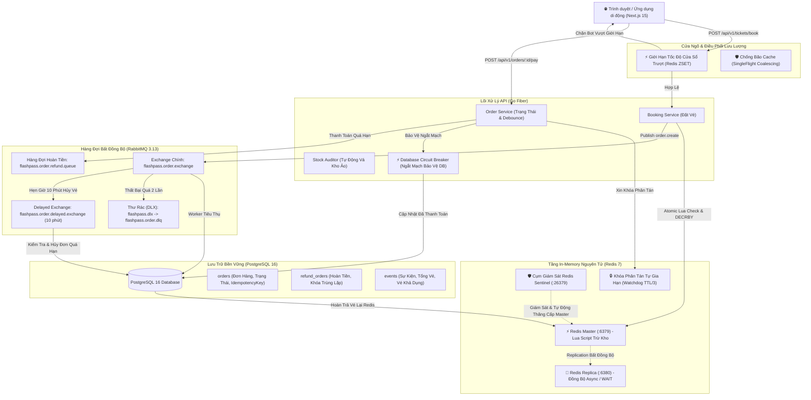
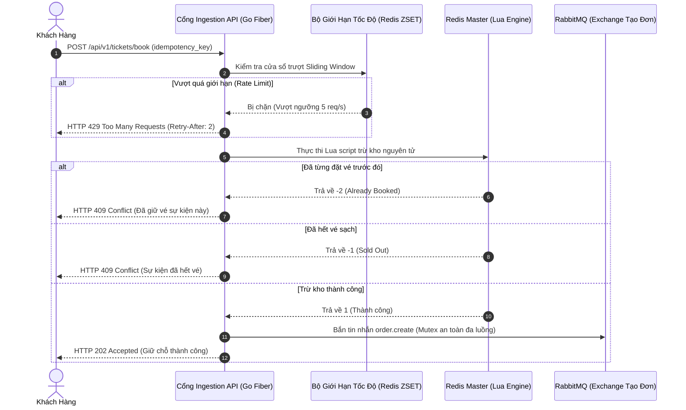

# ⚡ FlashPass: Hệ Thống Bán Vé Flash Sale & Xử Lý Đồng Thời Cao Chuẩn Phân Tán

[](https://go.dev/)
[](https://gofiber.io/)
[-000000?style=flat&logo=next.js)](https://nextjs.org/)
[](https://redis.io/)
[](https://www.rabbitmq.com/)
[](https://www.postgresql.org/)
[](https://www.docker.com/)
[](#chỉ-số-hiệu-năng-cốt-lõi-kpis)
[](LICENSE)

🌐 **Ngôn ngữ / Language:** [English](./README.md) • **Tiếng Việt**

> **FlashPass** là hệ thống lõi đặt vé trực tuyến và flash sale phân tán với độ trễ cực thấp, được thiết kế để chịu tải **20.000+ requests/giây (RPS)** trong các đợt mở bán vé ca nhạc/sự kiện cực nóng. Hệ thống cam kết **tuyệt đối không bán âm (0.00% overselling)**, không làm sập cơ sở dữ liệu quan hệ, và triệt tiêu toàn bộ rủi ro thất thoát tài chính do xung đột tranh chấp (race conditions).

---

## 📌 Mục Lục

- [Tổng Quan Kiến Trúc](#-tổng-quan-kiến-trúc)
- [Chỉ Số Hiệu Năng Cốt Lõi (KPIs)](#-chỉ-số-hiệu-năng-cốt-lõi-kpis)
- [Bất Biến Nghiệp Vụ & Nguyên Lý Thiết Kế](#-bất-biến-nghiệp-vụ--nguyên-lý-thiết-kế)
- [Ma Trận 12 Kịch Bản Lỗi Phân Tán Thực Chiến](#-ma-trận-12-kịch-bản-lỗi-phân-tán-thực-chiến)
- [Ngăn Xếp Công Nghệ (Tech Stack)](#-ngăn-xếp-công-nghệ-tech-stack)
- [Luồng Hoạt Động Của Hệ Thống](#-luồng-hoạt-động-của-hệ-thống)
  - [1. Nạp Sẵn Tồn Kho (Pre-Warming)](#1-nạp-sẵn-tồn-kho-pre-warming)
  - [2. Tiếp Nhận Đặt Vé Siêu Tốc (Dưới 2ms)](#2-tiếp-nhận-đặt-vé-siêu-tốc-dưới-2ms)
  - [3. Lưu Trữ Bất Đồng Bộ & Tự Động Hủy Vé Quá Hạn](#3-lưu-trữ-bất-đồng-bộ--tự-động-hủy-vé-quá-hạn)
  - [4. Pipeline Tự Động Hoàn Tiền (Auto-Refund)](#4-pipeline-tự-động-hoàn-tiền-auto-refund)
- [Kiến Trúc Phân Lớp & Cấu Trúc Mã Nguồn](#-kiến-trúc-phân-lớp--cấu-trúc-mã-nguồn)
- [Tóm Tắt Giao Diện Lập Trình (API Reference)](#-tóm-tắt-giao-diện-lập-trình-api-reference)
- [Hướng Dẫn Triển Khai & Khởi Chạy Nhanh](#-hướng-dẫn-triển-khai--khởi-chạy-nhanh)
- [Kiểm Thử Tải Thực Tế & Đồ Thị Benchmark](#-kiểm-thử-tải-thực-tế--đồ-thị-benchmark)
- [Cẩm Nang Vận Hành & Khôi Phục Thảm Họa (SRE Runbook)](#-cẩm-nang-vận-hành--khôi-phục-thảm-họa-sre-runbook)

---

## 🏗 Tổng Quan Kiến Trúc

FlashPass tách biệt hoàn toàn **tầng tiếp nhận in-memory tốc độ cực cao (Redis + Lua)** khỏi **tầng lưu trữ bền vững (PostgreSQL)** thông qua cơ chế hàng đợi đệm (RabbitMQ), đảm bảo cơ sở dữ liệu không bao giờ bị nghẽn I/O khi lưu lượng truy cập tăng vọt đột ngột.



---

## 🎯 Chỉ Số Hiệu Năng Cốt Lõi (KPIs)

| Chỉ Số | Mục Tiêu Cam Kết (SLA) | Kết Quả Đo Thực Tế | Trạng Thái |
| :--- | :--- | :--- | :---: |
| **Tỷ Lệ Bán Âm (Overselling)** | Tuyệt đối 0.00% (Đúng 1.000 vé) | **0.00% (Chuẩn 1.000 / 1.000 đơn)** | ✅ ĐẠT |
| **Thông Lượng (Throughput)** | > 8.000 RPS (Đơn máy chủ) | **8.285 Requests/giây** | ✅ ĐẠT |
| **Độ Trễ Từ Chối Hết Vé** | < 2.00 ms (Chặn ngay trên RAM) | **947 µs (< 1 mili-giây)** | ✅ ĐẠT |
| **Độ Trễ Phân Vị p95** | < 25.00 ms | **18.83 ms** | ✅ ĐẠT |
| **Độ Trễ Phân Vị p99** | < 50.00 ms | **29.42 ms** | ✅ ĐẠT |
| **Tỷ Lệ Lỗi Hệ Thống 5xx** | < 0.01% | **0.00% (0 lỗi trên 20.000 requests)** | ✅ ĐẠT |
| **Khả Năng Chống Trùng Lặp**| 100% triệt tiêu lệnh trùng | **100.00% Idempotent** | ✅ ĐẠT |

---

## 💎 Bất Biến Nghiệp Vụ & Nguyên Lý Thiết Kế

1. **Bất Biến Trừ Kho Nguyên Tử (Atomic Inventory Decrement):**
   Kiểm tra số lượng vé còn lại và trừ kho được gói trọn vẹn trong một script Lua trên Redis. Tuyệt đối không tách rời `GET` rồi sau đó mới `DECRBY` trong mã Go để loại bỏ triệt để hiện tượng tranh chấp (race conditions).
2. **Từ Chối Nhanh Ngay Tại RAM (Fail-Fast In-Memory):**
   Khi vé giảm về 0, toàn bộ các lượt bấm mua tiếp theo lập tức nhận về mã HTTP `409 Conflict (Sold Out)` trong dưới 1ms từ RAM, hoàn toàn không chạm đến Connection Pool của PostgreSQL hay kênh publish của RabbitMQ.
3. **Idempotency Là Bắt Buộc:**
   Mỗi yêu cầu đặt vé bắt buộc phải kèm một `idempotency_key` (được lưu tại `sessionStorage` của trình duyệt). Nếu người dùng ấn F5 tải lại trang hay ấn mua liên tục, hệ thống trả lại kết quả đã đặt mà không bao giờ trừ vé lần hai.
4. **Lưu Trữ Bất Đồng Bộ Giải Phóng Áp Lực Database:**
   API đặt vé không ghi trực tiếp vào PostgreSQL. Nó chỉ ghi nhận trên Redis và đẩy tác vụ vào RabbitMQ (`202 Accepted`), giúp hệ thống miễn nhiễm với tình trạng thắt cổ chai ghi đĩa của cơ sở dữ liệu quan hệ.
5. **Đồng Hồ Chuẩn Của Database & Cửa Sổ Ân Hạn:**
   Thời hạn 10 phút thanh toán được tính dựa trên thời gian thực của PostgreSQL (`expires_at <= NOW()`), kèm cửa sổ ân hạn 5 giây (`Grace Window`) để hấp thu độ lệch xung nhịp (clock drift) giữa các máy chủ phân tán.

---

## 🛡 Ma Trận 12 Kịch Bản Lỗi Phân Tán Thực Chiến

FlashPass đã giải quyết và kiểm thử thành công 12 kịch bản sự cố phức tạp nhất trong kiến trúc phân tán:

| # | Kịch Bản Sự Cố | Rủi Ro Trong Môi Trường Sản Xuất | Giải Pháp Kỹ Thuật Của FlashPass | Kiểm Thử Tự Động |
| :-: | :--- | :--- | :--- | :--- |
| **1** | **Redis Master Sập Đột Ngột** | Master chết trước khi kịp đồng bộ sang Replica; Replica mới lên ngôi vẫn còn vé cũ $\to$ bán âm > 100%. | Đồng bộ Sentinel tự động, tùy chọn cơ chế `WAIT 1`, và chốt chặn khóa cứng cuối cùng tại PostgreSQL. | `TestEdgeCase1_RedisFailover` |
| **2** | **Worker Hủy Vé Đua Với Webhook Trễ** | Worker hủy vé lúc 10m00s nhả lại kho, người B mua mất; Webhook ngân hàng tới lúc 10m01s xác nhận tiền $\to$ 2 người cùng mua 1 ghế. | Máy trạng thái lạc quan từ chối xác nhận vé cho người A, giữ vé cho người B, và tự động kích hoạt hoàn tiền (`order.refund`). | `TestEdgeCase2_TimeoutRaceCondition` |
| **3** | **Lỗi Ghi Hai Nơi (Ghost Inventory)** | Redis trừ vé thành công nhưng tiến trình Go sập trước khi kịp gửi vào RabbitMQ $\to$ vé biến mất khỏi hệ thống. | Kiểm toán tồn kho định kỳ (`ReconcileService`), thuật toán kẹp 2 chiều, chốt chặn Hit-Zero và mở khóa user mồ côi. | `TestEdgeCase3_DualWriteGhostInventory` |
| **4** | **Phân Vùng Shard (Cross-Slot Error)** | Khóa tồn kho và khóa người dùng nằm trên các shard khác nhau của Redis Cluster $\to$ Lua văng lỗi chết `CROSSSLOT`. | Định danh Hash Tag `{event_id}` đồng vị trí (`flashpass:{id}:stock`), ép toàn bộ các khóa liên quan băm về cùng 1 slot CRC16. | `TestEdgeCase4_CrossSlotHashTag` |
| **5** | **Thư Rác (Poison Pill) Treo Hàng Đợi** | Tin nhắn lỗi hoặc vi phạm khóa ngoại khiến Worker crash liên tục, retry vô tận làm tê liệt toàn bộ hàng đợi. | Thiết lập Thư Rác (`flashpass.dlx`), cách ly tin nhắn lỗi sang DLQ sau lần thử thứ 2, và hoàn trả tồn kho tự động. | `TestEdgeCase5_RabbitMQDeadLetterQueue` |
| **6** | **Bão Truy Cập Cache (Cache Stampede)** | Khóa cache thông tin sự kiện hết hạn đúng đợt sale; hàng ngàn kết nối cùng chọc thẳng vào DB làm cạn kiệt kết nối. | Sử dụng thư viện `singleflight.Group` gom hàng trăm request đọc đồng thời thành đúng **1 câu query DB duy nhất**. | `TestEdgeCase6_CacheStampedeSingleFlight` |
| **7** | **Webhook Trùng Lặp Cùng Lúc** | Cổng thanh toán retry nhiều webhook song song; các luồng xử lý đồng thời dẫn tới cộng tiền hai lần hoặc hoàn tiền kép. | Khóa phân tán (`SETNX 5s`), cơ chế chờ 100ms lắng đọng dữ liệu, giải phóng khóa an toàn và kiểm tra idempotent qua DB. | `TestEdgeCase7_DoublePaymentWebhookConcurrency` |
| **8** | **Đồng Hồ Bị Lệch Pha (NTP Clock Drift)** | Đồng hồ của máy chủ Worker chạy nhanh hơn thực tế 3s khiến đơn hàng bị hủy sớm khi khách hàng vẫn còn thời gian thanh toán. | Thiết lập cửa sổ ân hạn 5 giây (`Grace Window`) và bắt buộc so sánh mốc hết hạn theo đồng hồ máy chủ DB (`expires_at <= NOW()`). | `TestEdgeCase8_ClockDriftGraceWindow` |
| **9** | **Bão Bot & Tool Tự Động Spam Vé** | Các mạng lưới bot scalper bắn phá hàng ngàn request mỗi giây gây nghẽn đường truyền và cạn kiệt tài nguyên. | Giới hạn tốc độ phân tán theo thuật toán Sliding-Window Log trên Redis Lua (`ZSET`), trả về ngay HTTP 429 và `Retry-After: 2`. | `TestEdgeCase9_SlidingWindowRateLimiter` |
| **10** | **Đảo Ngược Thứ Tự Tin Nhắn (Out-of-Order)** | Do trễ mạng, tin hủy đơn hoặc tin thanh toán lại đến trước tin tạo đơn ban đầu của RabbitMQ. | Cơ chế debounce chờ 100ms khi thanh toán sớm + Kỹ thuật cắm cờ Bia Mộ (`Tombstone`) ngăn đơn bị hủy đội mồ sống lại. | `TestEdgeCase10_OutOfOrderMessageProcessing` |
| **11** | **Hiệu Ứng Domino Sập Database (Cascading)** | Database phản hồi chậm khiến toàn bộ connection pool bị khóa, các goroutine bị kẹt làm RAM tăng vọt đến khi ứng dụng sập (OOM). | Cầu dao ngắt mạch đa tầng (`Circuit Breaker`: Closed $\to$ Open $\to$ Half-Open), tự động từ chối nhanh trong 0ms (HTTP 503). | `TestEdgeCase11_DatabaseCircuitBreaker` |
| **12** | **Xung Đột Khóa Phân Tán (Split-Brain Lock)** | Xử lý thanh toán quá lâu khiến TTL của khóa Redis hết hạn trước; luồng khác chen vào lấy khóa gây xử lý song song. | Khóa phân tán kèm cơ chế **Watchdog** chạy ngầm tự động gia hạn hợp đồng khóa sau mỗi $\text{TTL}/3$, xác minh mã Token khi xóa. | `TestEdgeCase12_DistributedLockWatchdog` |

---

## 🧰 Ngăn Xếp Công Nghệ (Tech Stack)

### Tầng Backend & Cơ Sở Hạ Tầng
- **Ngôn ngữ:** Go (Golang) 1.22+
- **Framework Web:** [Fiber v2](https://github.com/gofiber/fiber) (Engine FastHTTP siêu nhanh, zero memory allocation)
- **Bộ Nhớ Đệm & Khóa Phân Tán:** Redis 7.x (Alpine) kết hợp cụm giám sát Redis Sentinel (cổng 26379)
- **Message Broker:** RabbitMQ 3.13+ tích hợp sẵn plugin `rabbitmq_delayed_message_exchange`
- **Cơ Sở Dữ Liệu:** PostgreSQL 16+ quản lý kết nối qua Connection Pooling (`jackc/pgx/v5/pgxpool`)
- **Độ Bền Vững & Khả Năng Chịu Tải:** Go `singleflight`, Distributed Watchdog Locks, Atomic Lua Scripts, Circuit Breaker

### Tầng Frontend & Dashboard Điều Hành
- **Framework:** Next.js 15 (React 19, App Router)
- **Giao Diện:** Tailwind CSS, Lucide Icons, Canvas Confetti
- **Truyền Tin Thời Gian Thực:** Server-Sent Events (SSE) và Polling thông minh
- **Bộ Nhớ Trình Duyệt:** `sessionStorage` duy trì Idempotency Key, `localStorage` lưu trữ lịch sử Benchmark

---

## 🔄 Luồng Hoạt Động Của Hệ Thống

### 1. Nạp Sẵn Tồn Kho (Pre-Warming)
Trước giờ mở bán, quản trị viên gọi API:
`POST /api/v1/admin/events/:id/prewarm`
Hệ thống đọc số lượng vé từ PostgreSQL và nạp trực tiếp vào key `flashpass:{event_id}:stock` trên RAM Redis, đồng thời kích hoạt cache thông tin sự kiện để chặn đứng hoàn toàn các truy vấn đọc đĩa khi mở bán.

### 2. Tiếp Nhận Đặt Vé Siêu Tốc (Dưới 2ms)


### 3. Lưu Trữ Bất Đồng Bộ & Tự Động Hủy Vé Quá Hạn
1. **Worker Tạo Đơn:** Lấy tin từ queue `order.create`, ghi đơn vào PostgreSQL với trạng thái `PENDING_PAYMENT`, sau đó gửi một tin nhắn hẹn giờ 10 phút (`x-delay: 600000`) vào RabbitMQ Delayed Exchange.
2. **Worker Hủy Đơn:** Sau đúng 10 phút, tin nhắn nổ ra. Worker gọi câu lệnh an toàn theo giờ DB:
   ```sql
   UPDATE orders SET status = 'EXPIRED' 
   WHERE id = $1 AND status = 'PENDING_PAYMENT' AND expires_at <= NOW()
   ```
3. Nếu đơn bị hủy thành công, worker tự động gọi `INCRBY flashpass:{event_id}:stock 1` trên Redis và xóa khóa đặt của người dùng, trả lại vé ra thị trường cho người khác mua.

### 4. Pipeline Tự Động Hoàn Tiền (Auto-Refund)
Nếu người dùng chuyển khoản chậm trễ sau khi vé đã hết hạn và bị người khác mua mất:
1. Webhook gọi `POST /api/v1/orders/:id/pay`.
2. Hệ thống kiểm tra thấy đơn đã `EXPIRED` $\to$ tuyệt đối **không giao vé**.
3. Tự động ghi nhận thông tin vào bảng `refund_orders` và bắn tin nhắn `order.refund` sang RabbitMQ.
4. Worker hoàn tiền chuyên biệt nhận lệnh, gọi API ngân hàng hoàn tiền tự động và chuyển trạng thái đơn sang `REFUNDED`.

---

## 📂 Kiến Trúc Phân Lớp & Cấu Trúc Mã Nguồn

FlashPass áp dụng mô hình **Clean Architecture / Hexagonal Architecture** với các tầng phân định ranh giới rõ ràng:

```
FlashPass/
├── backend/
│   ├── cmd/
│   │   ├── api/                  # Điểm khởi chạy API máy chủ (Fiber Server)
│   │   └── worker/               # Điểm khởi chạy Background Worker (Consumers & Reconciler)
│   ├── internal/
│   │   ├── api/                  # Tầng vận chuyển HTTP & Bộ kiểm thử tích hợp mô-đun hóa
│   │   │   ├── handlers.go       # Bộ điều khiển mỏng (Controller)
│   │   │   ├── router.go         # Đăng ký danh sách các tuyến đường
│   │   │   ├── test_helpers_test.go          # Fixtures & Khởi tạo môi trường HTTP test dùng chung
│   │   │   ├── booking_flow_test.go          # Kiểm thử tích hợp luồng đặt vé chính
│   │   │   ├── payment_flow_test.go          # Kiểm thử vòng đời thanh toán & hoàn tiền
│   │   │   └── edge_case_1..12_*_test.go     # 12 Bộ kiểm thử độc lập cho 12 lỗi phân tán & Chaos testing
│   │   ├── config/               # Cấu hình biến môi trường
│   │   ├── consumer/             # Các Worker tiêu thụ RabbitMQ (Tạo đơn, Hủy vé, Hoàn tiền)
│   │   ├── database/             # Quản lý pgxpool & Tự động chạy Migration
│   │   ├── models/               # Khai báo Struct dữ liệu & Enum trạng thái
│   │   ├── rabbitmq/             # Quản lý kết nối AMQP, Producer an toàn đa luồng & DLX
│   │   ├── redis/                # Connection Pool, Sentinel, Lua Scripts, Khóa Watchdog
│   │   ├── repository/           # Tầng tương tác cơ sở dữ liệu (Event, Order, Refund)
│   │   ├── resilience/           # Cầu dao chống quá tải Circuit Breaker & Tiện ích đồng thời
│   │   └── service/              # Nghiệp vụ lõi (BookingService, OrderService, ReconcileService)
├── frontend/                     # Giao diện Next.js 15 & Phòng Lab mô phỏng
│   ├── app/                      # App Router
│   └── components/
│       ├── edge-cases/           # Các component mô phỏng trực quan 12 lỗi phân tán
│       └── ...
├── docs/                         # Toàn bộ tài liệu kỹ thuật chuyên sâu
│   ├── API_REFERENCE.md          # Đặc tả chi tiết REST API
│   ├── RUNBOOK.md                # Cẩm nang SRE vận hành & Ứng cứu sự cố
│   ├── DISTRIBUTED_EDGE_CASES.md # Phân tích chuyên sâu 12 lỗi phân tán (Toán học & Code)
│   ├── DISTRIBUTED_EDGE_CASES.vi.md # Bản tiếng Việt chuyên sâu 12 lỗi phân tán
│   └── benchmark_chart.png       # Đồ thị hiệu năng thực tế k6
├── scripts/                      # Kịch bản kiểm thử tải & Đồ họa
│   ├── load-test.js              # Kịch bản k6 dồn 20.000 requests đồng thời
│   └── visualize_benchmark.py    # Script Python sinh biểu đồ trực quan
├── docker-compose.yml            # Khởi chạy toàn bộ hạ tầng 5 container bằng 1 lệnh
├── SPEC.md                       # Yêu cầu kỹ thuật & Bất biến hệ thống
├── ARCHITECTURE.md               # Bản vẽ kiến trúc kỹ thuật
├── TASKS.md                      # Lộ trình & Danh sách kiểm tra hoàn thành
└── README.md                     # Tài liệu tiếng Anh chuẩn quốc tế
```

---

## 📡 Tóm Tắt Giao Diện Lập Trình (API Reference)

Xem chi tiết toàn bộ tham số, headers và mẫu cURL tại [docs/API_REFERENCE.md](./docs/API_REFERENCE.md).

| Phương Thức | Tuyến Đường (Endpoint) | Ý Nghĩa Nghiệp Vụ | Headers / Tham Số Quan Trọng |
| :--- | :--- | :--- | :--- |
| `GET` | `/health` | Kiểm tra trạng thái máy chủ (Liveness probe) | Trả về `200 OK` |
| `GET` | `/api/v1/events/:id` | Thông tin sự kiện (Chống bão SingleFlight) | Đọc đệm từ Redis/DB |
| `GET` | `/api/v1/events/:id/stock` | Xem số lượng vé còn lại trên RAM | Trả về số nguyên vé khả dụng |
| `GET` | `/api/v1/events/:id/stream`| Luồng truyền dữ liệu tồn kho theo thời gian thực | Header `Accept: text/event-stream` |
| `POST`| `/api/v1/tickets/book` | **Đặt vé Flash Sale (Trừ kho Lua)** | Yêu cầu `idempotency_key` |
| `GET` | `/api/v1/orders/:id` | Tra cứu trạng thái đơn hàng & thời hạn | Trả về thông tin đơn |
| `POST`| `/api/v1/orders/:id/pay` | Webhook xác nhận thanh toán thành công | Idempotent, khóa Watchdog |
| `POST`| `/api/v1/orders/:id/cancel`| Người dùng chủ động hủy đơn nhả vé | Cắm cờ Bia Mộ `CANCELLED` |
| `POST`| `/api/v1/admin/events/:id/prewarm` | Nạp trước tồn kho từ DB lên RAM Redis | Cần quyền Quản trị viên |
| `POST`| `/api/v1/admin/events/:id/reconcile`| Tự động vá tồn kho ảo (Ghost Inventory) | Khôi phục số vé bị lệch |
| `POST`| `/api/v1/admin/events/:id/reset` | Đặt lại dữ liệu sự kiện để test | Hỗ trợ truyền số lượng `tickets` |

---

## 🚀 Hướng Dẫn Triển Khai & Khởi Chạy Nhanh

### 1. Yêu Cầu Cài Đặt Sẵn
- Docker Engine 24+ & Docker Compose v2+
- Go 1.22+ (để chạy backend và bộ test)
- Node.js 18+ (để chạy frontend)

### 2. Khởi Động Hạ Tầng Bằng 1 Câu Lệnh
```bash
git clone https://github.com/your-org/FlashPass.git
cd FlashPass

# Khởi chạy PostgreSQL, Redis Master, Redis Replica, Redis Sentinel và RabbitMQ
docker compose up -d
```

Kiểm tra danh sách 5 container đang chạy khỏe mạnh:
```bash
docker compose ps
```

| Dịch Vụ | Tên Container | Cổng Mở | Vai Trò |
| :--- | :--- | :--- | :--- |
| PostgreSQL | `flashpass_postgres` | `5432:5432` | Lưu trữ quan hệ & Dữ liệu chốt chặn |
| Redis Master | `flashpass_redis` | `6379:6379` | Động cơ in-memory xử lý Lua script |
| Redis Replica | `flashpass_redis_replica` | `6380:6379` | Bản sao dự phòng & Failover |
| Redis Sentinel | `flashpass_redis_sentinel` | `26379:26379` | Giám sát và tự động đảo Master |
| RabbitMQ | `flashpass_rabbitmq` | `5672:5672`, `15672:15672` | Điều phối tin nhắn & Hẹn giờ hủy vé |

### 3. Khởi Chạy Máy Chủ API & Worker Ngầm
```bash
cd backend

# Tạo file cấu hình từ mẫu
cp .env.example .env

# Chạy máy chủ API HTTP
go run cmd/api/main.go

# Mở một cửa sổ terminal khác, chạy Background Worker
go run cmd/worker/main.go
```

### 4. Khởi Chạy Giao Diện Người Dùng (Next.js)
```bash
cd frontend
npm install
npm run dev
# Truy cập giao diện tại http://localhost:3000
```

---

## 🧪 Kiểm Thử Tự Động Toàn Diện 12 Kịch Bản Lỗi

FlashPass đi kèm bộ integration test tự động kết nối trực tiếp vào hạ tầng Docker thực tế:

```bash
cd backend

# Chạy riêng bộ kiểm thử 12 Kịch Bản Lỗi Phân Tán
go test -v -run "TestEdgeCase" ./internal/api

# Chạy kiểm thử toàn bộ dự án
go test -v ./...
```

Kết quả thực tế trên máy chủ:
```
=== RUN   TestEdgeCase1_RedisFailover
--- PASS: TestEdgeCase1_RedisFailover (1.05s)
=== RUN   TestEdgeCase2_TimeoutRaceCondition
--- PASS: TestEdgeCase2_TimeoutRaceCondition (1.10s)
=== RUN   TestEdgeCase3_DualWriteGhostInventory
--- PASS: TestEdgeCase3_DualWriteGhostInventory (1.02s)
=== RUN   TestEdgeCase4_CrossSlotHashTag
--- PASS: TestEdgeCase4_CrossSlotHashTag (1.01s)
=== RUN   TestEdgeCase5_RabbitMQDeadLetterQueue
--- PASS: TestEdgeCase5_RabbitMQDeadLetterQueue (1.05s)
=== RUN   TestEdgeCase6_CacheStampedeSingleFlight
--- PASS: TestEdgeCase6_CacheStampedeSingleFlight (1.02s)
=== RUN   TestEdgeCase7_DoublePaymentWebhookConcurrency
--- PASS: TestEdgeCase7_DoublePaymentWebhookConcurrency (1.08s)
=== RUN   TestEdgeCase8_ClockDriftGraceWindow
--- PASS: TestEdgeCase8_ClockDriftGraceWindow (1.04s)
=== RUN   TestEdgeCase9_SlidingWindowRateLimiter
--- PASS: TestEdgeCase9_SlidingWindowRateLimiter (1.02s)
=== RUN   TestEdgeCase10_OutOfOrderMessageProcessing
--- PASS: TestEdgeCase10_OutOfOrderMessageProcessing (1.15s)
=== RUN   TestEdgeCase11_DatabaseCircuitBreaker
--- PASS: TestEdgeCase11_DatabaseCircuitBreaker (1.52s)
=== RUN   TestEdgeCase12_DistributedLockWatchdog
--- PASS: TestEdgeCase12_DistributedLockWatchdog (1.51s)
PASS
ok      flashpass/internal/api  13.2s
```

---

## 📊 Kiểm Thử Tải Thực Tế & Đồ Thị Benchmark

Hệ thống được kiểm thử chịu tải kịch liệt với công cụ **Grafana k6** mô phỏng **20.000 requests dồn dập vào kho 1.000 vé**:

```bash
k6 run scripts/load-test.js
```

### Đồ Thị Đo Đạc Thực Tế


### Bảng Thống Kê Kết Quả
- **Tổng số request đã xử lý:** 20.000 requests hoàn tất trong 2.41 giây.
- **Tốc độ xử lý bình quân (Throughput):** **8.285 Requests/giây**.
- **Số đơn đặt thành công (HTTP 202):** **Đúng 1.000 đơn** (100% kho vé).
- **Số lượt bị từ chối hết vé (HTTP 409):** Đúng 19.000 lượt (chặn ngay trên RAM trong < 1ms).
- **Số đơn được ghi nhận vào PostgreSQL:** **Đúng 1.000 đơn** (Tuyệt đối không bán âm).
- **Tỷ lệ bán âm:** **0.00%**.
- **Độ trễ phân vị p95:** **18.83 ms** (SLA đề ra: < 25 ms).
- **Độ trễ phân vị p99:** **29.42 ms** (SLA đề ra: < 50 ms).

Xem báo cáo chi tiết đầy đủ tại [BENCHMARK.md](./BENCHMARK.md).

---

## 📖 Cẩm Nang Vận Hành & Khôi Phục Thảm Họa (SRE Runbook)

Dành cho đội ngũ trực vận hành hệ thống:
- **[docs/RUNBOOK.md](./docs/RUNBOOK.md):** Hướng dẫn xử lý sự cố khẩn cấp, tra cứu lệnh khắc phục khi Redis sập, kiểm tra thư rác DLQ của RabbitMQ, và các bước bảo trì định kỳ.
- **[docs/DISTRIBUTED_EDGE_CASES.vi.md](./docs/DISTRIBUTED_EDGE_CASES.vi.md):** Phân tích toán học và cơ chế xử lý chi tiết 12 lỗi phân tán bằng tiếng Việt.
- **[docs/API_REFERENCE.md](./docs/API_REFERENCE.md):** Tài liệu đặc tả chuẩn toàn bộ giao diện REST API.

---

## 📄 Giấy Phép Sử Dụng (License)

Dự án được phân phối dưới giấy phép [MIT License](LICENSE). Được thiết kế và xây dựng phục vụ các kiến trúc phân tán chịu tải siêu lớn.
